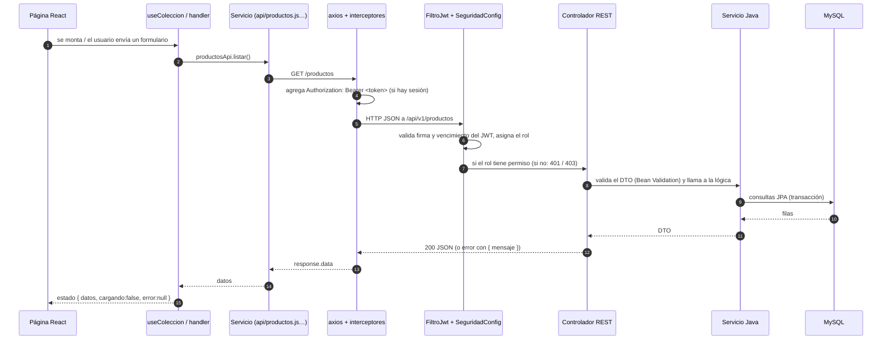
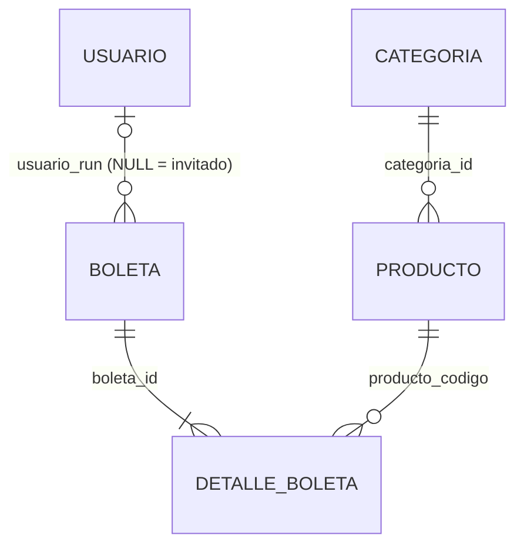
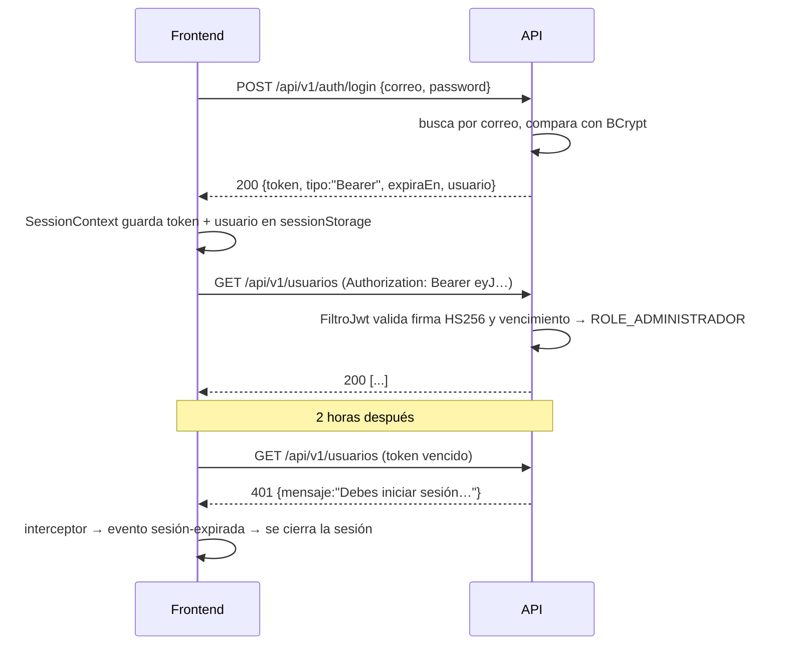

# Documento de APIs e Integración — Sonido Vivo (Etapa 3)

Versión 1.0 · 06-11-2026 · DSY1104 Desarrollo Fullstack II · Evaluación Parcial 3

Este documento explica cómo se comunican el frontend React y el backend Spring Boot: el **modelo de la base de datos**, los **endpoints** (con permisos por rol, entradas y salidas), la **seguridad**, cómo los consume el **frontend**, las **pruebas** realizadas y el **resultado de la comunicación**.
La referencia completa y navegable de la API es la especificación OpenAPI (`docs/openapi.json`), que también se ve en Swagger UI con la API en ejecución: `http://localhost:8080/swagger-ui.html`.

| Proyecto | Repositorio | Tecnología |
|---|---|---|
| Frontend | `Tienda-Sonido-Vivo` → `fase3/proyecto_Etapa3_REACT` | React 19, Vite 8, Bootstrap 5, axios 1.12 |
| Backend | `sonido-vivo-api` (repositorio separado) | Spring Boot 3.5, Java 21, Spring Data JPA, Spring Security, jjwt 0.12, springdoc 2.8 |
| Base de datos | MySQL 8 (H2 en memoria para desarrollo y pruebas) | 5 tablas |

---

## 1. Arquitectura de la integración



**Capas del backend** (`sonidovivo`):

| Paquete | Contenido |
|---|---|
| `controlador` | 6 controladores REST: `AuthControlador`, `ProductoControlador`, `CategoriaControlador`, `UsuarioControlador`, `BoletaControlador`, `ReporteControlador` |
| `servicio` | Lógica de negocio: `BoletaServicio` (checkout), `ProductoServicio`, `CategoriaServicio`, `UsuarioServicio`, `AuthServicio`, `ReporteServicio`, `Textos` (RUN, slug) |
| `repositorio` | Interfaces Spring Data JPA, una por tabla |
| `modelo` | Entidades JPA de las 5 tablas + `TipoUsuario` y `Cupon` (enumeraciones) |
| `dto` | Records de entrada (`*Request`) y salida (`*DTO`) con validaciones |
| `seguridad` | `SeguridadConfig` (reglas por rol, CORS, BCrypt), `FiltroJwt`, `JwtServicio`, `SesionActual` |
| `excepcion` | `RecursoNoEncontradoException` (404), `ConflictoException` (409), `ReglaNegocioException` (400) y `ManejadorErrores` |
| `config` | `AppConfig` (Swagger, reloj) y `CargaInicial` (datos semilla) |

---

## 2. Modelo de la base de datos

Basado en la Figura 1 del enunciado. La relación USUARIO ┄ BOLETA (línea punteada) es **opcional**: se puede comprar sin cuenta.



| Tabla | Clave primaria | Claves foráneas | Únicos | Notas |
|---|---|---|---|---|
| `usuario` | `run` varchar(12) | — | `correo` | `password` con BCrypt; `tipo_usuario` ∈ {ADMINISTRADOR, VENDEDOR, CLIENTE} |
| `categoria` | `id` varchar(60) (slug del nombre) | — | `nombre` | El id no cambia al renombrar |
| `producto` | `codigo` varchar(20) | `categoria_id` → `categoria.id` | — | Precios en CLP enteros; `stock_critico` por defecto 3 |
| `boleta` | `id` bigint autoincremental | `usuario_run` → `usuario.run` (**NULL permitido**) | — | Copia nombre, correo y dirección del cliente; guarda cupón, subtotal, descuento y total |
| `detalle_boleta` | `id` bigint autoincremental | `boleta_id` → `boleta.id`, `producto_codigo` → `producto.codigo` | — | `precio_unitario` = precio cobrado al momento de la compra |

**Reglas de integridad que aplica el backend además de las FK:** no se elimina una categoría con productos (409); no se elimina un producto que aparece en boletas (409); al eliminar un usuario, sus boletas se conservan con `usuario_run = NULL`.

### 2.1 DDL (MySQL, generado por Hibernate)

El script completo está en `sonido-vivo-api/db/schema-mysql.sql`. No hace falta ejecutarlo: con `DDL_AUTO=update` la API crea las tablas al arrancar.

```sql
create table categoria (
  id varchar(60) not null, nombre varchar(50) not null, descripcion varchar(200), color varchar(7),
  primary key (id)) engine=InnoDB;

create table producto (
  codigo varchar(20) not null, nombre varchar(100) not null, categoria_id varchar(60) not null,
  marca varchar(60), modelo varchar(60), descripcion varchar(500), imagen varchar(500),
  precio integer not null, stock integer not null, stock_critico integer not null,
  oferta bit not null, precio_oferta integer,
  primary key (codigo)) engine=InnoDB;

create table usuario (
  run varchar(12) not null, nombre varchar(50) not null, apellidos varchar(100) not null,
  correo varchar(100) not null, password varchar(100) not null, fecha_nacimiento date,
  tipo_usuario enum ('ADMINISTRADOR','CLIENTE','VENDEDOR') not null,
  region varchar(100), comuna varchar(100), direccion varchar(300),
  primary key (run)) engine=InnoDB;

create table boleta (
  id bigint not null auto_increment, fecha datetime(6) not null, estado varchar(20) not null,
  usuario_run varchar(12),
  nombre_cliente varchar(50) not null, apellidos_cliente varchar(100) not null, correo_cliente varchar(100) not null,
  calle varchar(150) not null, departamento varchar(20), region varchar(100) not null, comuna varchar(100) not null,
  indicaciones varchar(300), cupon varchar(30),
  subtotal integer not null, descuento integer not null, total integer not null,
  primary key (id)) engine=InnoDB;

create table detalle_boleta (
  id bigint not null auto_increment, boleta_id bigint not null, producto_codigo varchar(20) not null,
  cantidad integer not null, precio_unitario integer not null, subtotal integer not null,
  primary key (id)) engine=InnoDB;

alter table categoria add constraint uk_categoria_nombre unique (nombre);
alter table usuario add constraint uk_usuario_correo unique (correo);
alter table producto add constraint fk_producto_categoria foreign key (categoria_id) references categoria (id);
alter table boleta add constraint fk_boleta_usuario foreign key (usuario_run) references usuario (run);
alter table detalle_boleta add constraint fk_detalle_boleta foreign key (boleta_id) references boleta (id);
alter table detalle_boleta add constraint fk_detalle_producto foreign key (producto_codigo) references producto (codigo);
```

*(Arriba se reordenaron las columnas y se renombraron las restricciones para leerlo mejor; Hibernate genera nombres automáticos como `FKodqr7965…`.)*

### 2.2 Datos iniciales

Al arrancar con las tablas vacías, `CargaInicial` inserta **10 categorías, 51 productos y 3 usuarios** de demostración (`src/main/resources/semilla/*.json`, generados desde el `seed.js` de la Etapa 2). Se desactiva con `SEMILLA=false`.

---

## 3. Seguridad

### 3.1 Autenticación con JWT



- **Contenido del token:** `sub` = RUN, `rol` = ADMINISTRADOR / VENDEDOR / CLIENTE, `nombre`, `iat`, `exp`. No lleva datos sensibles.
- **Firma:** HMAC-SHA256 con la clave `JWT_SECRET` (Base64, mínimo 256 bits). Vigencia: `JWT_EXPIRACION_MINUTOS` (120 por defecto).
- **Sin estado:** no hay sesión en el servidor ni cookies; por eso CSRF no aplica y se desactiva.
- **Contraseñas:** BCrypt. La API nunca devuelve el campo `password`.
- **Login:** el mismo mensaje para correo inexistente o clave incorrecta (no revela qué cuentas existen).
- **CORS:** solo los orígenes de `CORS_ORIGINS`; métodos GET, POST, PUT, DELETE y OPTIONS; encabezados `Authorization` y `Content-Type`.

### 3.2 Matriz de permisos por endpoint

✔ permitido · 401 sin token o token inválido · 403 el rol no tiene permiso.

| Endpoint | Visitante | Cliente | Vendedor | Admin |
|---|:-:|:-:|:-:|:-:|
| `POST /auth/login`, `POST /auth/registro` | ✔ | ✔ | ✔ | ✔ |
| `GET /auth/me` | 401 | ✔ | ✔ | ✔ |
| `GET /productos`, `GET /productos/{codigo}` | ✔ | ✔ | ✔ | ✔ |
| `GET /productos/criticos` | 401 | 403 | 403 | ✔ |
| `POST /productos`, `PUT/DELETE /productos/{codigo}` | 401 | 403 | 403 | ✔ |
| `GET /categorias`, `GET /categorias/{id}` | ✔ | ✔ | ✔ | ✔ |
| `POST /categorias`, `PUT/DELETE /categorias/{id}` | 401 | 403 | 403 | ✔ |
| `POST /boletas` | ✔ | ✔ | ✔ | ✔ |
| `GET /boletas` | 401 | 403 | ✔ | ✔ |
| `GET /boletas/{id}` | 401 | solo suyas (403 si es ajena) | ✔ | ✔ |
| `GET/PUT /usuarios/me`, `GET /usuarios/me/boletas` | 401 | ✔ | ✔ | ✔ |
| `GET/POST /usuarios`, `GET/PUT/DELETE /usuarios/{run}`, `GET /usuarios/{run}/boletas` | 401 | 403 | 403 | ✔ |
| `GET /reportes/ventas` | 401 | 403 | 403 | ✔ |
| `/swagger-ui.html`, `/v3/api-docs` | ✔ | ✔ | ✔ | ✔ |

El **Vendedor** solo lee productos y órdenes, como pide el enunciado. La misma regla se refleja en la interfaz (`utils/roles.js`): su menú lateral solo tiene Productos y Órdenes, la lista de productos no muestra crear/editar/eliminar y cualquier otra ruta del panel muestra "No tienes permisos para ver esta sección." sin llamar a la API.

---

## 4. Endpoints

Base: `http://localhost:8080/api/v1` · Formato: JSON UTF-8 · 16 rutas, 27 operaciones.

### 4.1 Autenticación — `/auth`

| Método | Ruta | Cuerpo | Respuesta | Errores |
|---|---|---|---|---|
| POST | `/auth/login` | `{correo, password}` | 200 `AuthRespuesta` | 400 faltan datos · 401 credenciales |
| POST | `/auth/registro` | `RegistroRequest` (run, nombre, apellidos, correo, password, region, comuna, direccion, fechaNacimiento?) | 201 `AuthRespuesta` (rol siempre Cliente) | 400 validación · 409 RUN o correo repetido |
| GET | `/auth/me` | — | 200 `UsuarioDTO` | 401 |

```json
// POST /api/v1/auth/login  →  200
{
  "token": "eyJhbGciOiJIUzI1NiJ9.eyJzdWIiOiIxMTExMTExMS0xIiwicm9sIjoiQURNSU5JU1RSQURPUiIs…",
  "tipo": "Bearer",
  "expiraEn": "2026-11-06T17:09:20Z",
  "usuario": { "run": "11111111-1", "nombre": "María", "apellidos": "Pérez Soto", "correo": "maria.perez@gmail.com",
               "fechaNacimiento": "1985-04-12", "tipoUsuario": "Administrador",
               "region": "Región de Valparaíso", "comuna": "Viña del Mar", "direccion": "Av. Libertad 1234" }
}
```

### 4.2 Productos — `/productos`

| Método | Ruta | Parámetros / cuerpo | Respuesta | Errores |
|---|---|---|---|---|
| GET | `/productos` | `?categoria={id}&q={texto}&oferta=true` (opcionales) | 200 `ProductoDTO[]` ordenados por código | — |
| GET | `/productos/criticos` | — | 200 `ProductoDTO[]` con `stock <= stockCritico` | 401 · 403 |
| GET | `/productos/{codigo}` | — | 200 `ProductoDTO` | 404 |
| POST | `/productos` | `ProductoRequest` | 201 `ProductoDTO` | 400 · 401 · 403 · 409 código repetido |
| PUT | `/productos/{codigo}` | `ProductoRequest` (el código de la URL manda) | 200 `ProductoDTO` | 400 · 404 |
| DELETE | `/productos/{codigo}` | — | 204 | 404 · 409 tiene ventas |

```json
// ProductoRequest (POST/PUT)
{ "codigo": "AC010", "nombre": "Cable de instrumento 3 m", "categoriaId": "accesorios",
  "marca": "Fender", "modelo": "", "descripcion": "", "imagen": "",
  "precio": 9990, "stock": 10, "stockCritico": null, "oferta": false, "precioOferta": null }

// ProductoDTO
{ "codigo": "GA001", "nombre": "Guitarra Acústica Folk", "categoriaId": "guitarras-acusticas", "categoria": "Guitarras Acústicas",
  "marca": "Yamaha", "modelo": "F310", "descripcion": "Tapa de abeto…", "imagen": "https://…",
  "precio": 129990, "stock": 8, "stockCritico": 3, "oferta": true, "precioOferta": 110490,
  "precioVigente": 110490, "critico": false }
```

Validaciones de `ProductoRequest`: código obligatorio de 3 a 20 caracteres; nombre obligatorio (máx. 100); `categoriaId` debe existir; precio y stock obligatorios, enteros ≥ 0; stock crítico ≥ 0 (3 si viene vacío); si `oferta = true`, `precioOferta` obligatorio y ≤ `precio`.

### 4.3 Categorías — `/categorias`

| Método | Ruta | Cuerpo | Respuesta | Errores |
|---|---|---|---|---|
| GET | `/categorias` | — | 200 `CategoriaDTO[]` (incluye `cantidadProductos`) | — |
| GET | `/categorias/{id}` | — | 200 `CategoriaDTO` | 404 |
| POST | `/categorias` | `{nombre, descripcion?, color?}` | 201 (id = slug del nombre) | 400 · 409 nombre repetido |
| PUT | `/categorias/{id}` | `{nombre, descripcion?, color?}` | 200 | 404 · 409 |
| DELETE | `/categorias/{id}` | — | 204 | 404 · 409 tiene productos |

### 4.4 Usuarios — `/usuarios`

| Método | Ruta | Cuerpo | Respuesta | Errores |
|---|---|---|---|---|
| GET | `/usuarios/me` | — | 200 `UsuarioDTO` | 401 |
| PUT | `/usuarios/me` | `PerfilRequest` (nombre, apellidos, password?, fechaNacimiento?, region, comuna, direccion) — **sin** run, correo ni tipo | 200 | 400 · 401 |
| GET | `/usuarios/me/boletas` | — | 200 `BoletaDTO[]` | 401 |
| GET | `/usuarios` | — | 200 `UsuarioDTO[]` | 401 · 403 |
| GET | `/usuarios/{run}` | — | 200 | 404 |
| GET | `/usuarios/{run}/boletas` | — | 200 `BoletaDTO[]` (historial) | 404 |
| POST | `/usuarios` | `UsuarioRequest` (incluye `tipoUsuario`; password obligatoria) | 201 | 400 · 409 RUN/correo |
| PUT | `/usuarios/{run}` | `UsuarioRequest` (password vacía o null = se conserva) | 200 | 404 · 409 correo de otro |
| DELETE | `/usuarios/{run}` | — | 204 (sus boletas quedan sin dueño) | 404 · 409 eliminarse a sí mismo |

### 4.5 Boletas — `/boletas`

| Método | Ruta | Cuerpo | Respuesta | Errores |
|---|---|---|---|---|
| POST | `/boletas` | `BoletaRequest` (token **opcional**) | 201 `BoletaDTO` | 400 validación / cupón inválido / carrito vacío · 404 producto · 409 stock |
| GET | `/boletas` | — | 200 `BoletaDTO[]`, más recientes primero | 401 · 403 |
| GET | `/boletas/{id}` | — | 200 `BoletaDTO` | 401 · 403 ajena · 404 |

```json
// BoletaRequest — el frontend NO envía precios ni totales
{ "cliente":   { "nombre": "Ana", "apellidos": "Soto", "correo": "ana@gmail.com" },
  "direccion": { "calle": "Calle 1", "departamento": "", "region": "Región de Valparaíso", "comuna": "Quilpué", "indicaciones": "" },
  "items": [ { "codigo": "GA001", "cantidad": 2 }, { "codigo": "GA001", "cantidad": 1 } ],
  "cupon": "sonidovivo10" }

// 201 BoletaDTO (respuesta real del backend a la petición anterior, sin sesión)
{ "id": 1, "fecha": "2026-11-06T15:09:21.213921100Z", "estado": "Pagada",
  "cliente":   { "run": null, "nombre": "Ana", "apellidos": "S", "correo": "ana@gmail.com" },
  "direccion": { "calle": "C 1", "departamento": null, "region": "R", "comuna": "X", "indicaciones": null },
  "items": [ { "codigo": "GA001", "nombre": "Guitarra Acústica Folk", "precio": 110490, "cantidad": 3, "subtotal": 331470 } ],
  "cupon": "SONIDOVIVO10", "subtotal": 331470, "descuento": 33147, "total": 298323 }
```

Observa en el ejemplo real: los dos ítems de `GA001` se **agruparon** (3 unidades), se cobró el **precio de oferta** de la base (110.490), el cupón se normalizó a mayúsculas, el descuento se redondeó a pesos y `cliente.run` es `null` porque se compró sin sesión.

**Algoritmo del checkout (`BoletaServicio.crear`, una transacción):**
1. Valida el cupón (si viene) → 400 si no existe.
2. Agrupa los ítems por código.
3. Por cada producto: lo lee con **bloqueo de fila** (`SELECT … FOR UPDATE`); si no existe → 404; si `stock < cantidad` → 409 y se revierte todo.
4. Precio unitario = precio vigente de la base; subtotal de línea = precio × cantidad; descuenta el stock.
5. Descuento = `round(subtotal × porcentaje)`; total = subtotal − descuento.
6. Asocia el usuario del token (si hay) y guarda BOLETA + DETALLE_BOLETA.

### 4.6 Reportes — `/reportes`

| Método | Ruta | Respuesta |
|---|---|---|
| GET | `/reportes/ventas` | 200 `{cantidadOrdenes, totalVendido, ticketPromedio, unidadesEnStock, topProductos[5], porCategoria[]}` (solo Admin) |

### 4.7 Formato de error (todas las rutas)

```json
{ "fecha": "2026-11-06T15:09:22.244Z", "estado": 400, "error": "Bad Request",
  "mensaje": "Los apellidos son obligatorios.", "ruta": "/api/v1/auth/registro",
  "errores": { "apellidos": "Los apellidos son obligatorios.", "run": "El RUN ingresado no es válido. Usa el formato 12345678-5.",
               "correo": "Solo se aceptan correos @duoc.cl, @profesor.duoc.cl o @gmail.com.", "...": "..." } }
```

| Código | Cuándo |
|---|---|
| 400 | Validación del DTO (`errores` por campo), JSON mal formado, regla de negocio (cupón inválido, carrito vacío, oferta mayor al precio, RUN con dígito verificador incorrecto) |
| 401 | Ruta protegida sin token, token inválido o vencido; login con credenciales incorrectas |
| 403 | El rol no tiene permiso; un cliente pide una boleta ajena |
| 404 | Recurso inexistente o ruta inexistente |
| 409 | Duplicados (código, RUN, correo, nombre de categoría), stock insuficiente, categoría con productos, producto con ventas, eliminarse a sí mismo |
| 500 | Error inesperado (se registra en el log; al usuario se le muestra un mensaje genérico) |

### 4.8 Documentación con Swagger

- **Swagger UI:** `http://localhost:8080/swagger-ui.html`. Cada operación tiene resumen, descripción, parámetros, ejemplos y respuestas posibles, agrupadas por etiqueta (Autenticación, Productos, Categorías, Usuarios, Boletas, Reportes).
- **Probar endpoints protegidos:** ejecutar `POST /api/v1/auth/login`, copiar el `token`, pulsar **Authorize** y pegarlo (sin la palabra Bearer).
- **Especificación:** `http://localhost:8080/v3/api-docs` (OpenAPI 3). Copia versionada en `docs/openapi.json`; la prueba `ApiIntegracionTest.exportaOpenApi` la regenera en `target/openapi.json` en cada `./mvnw test`.

---

## 5. Integración en el frontend

### 5.1 Piezas

| Archivo | Responsabilidad |
|---|---|
| `src/api/cliente.js` | Instancia de **axios** (`baseURL` = `VITE_API_URL` o `http://localhost:8080/api/v1`, timeout 15 s). **Interceptor de petición:** agrega `Authorization: Bearer <token>` si hay sesión. **Interceptor de respuesta:** un 401 de una petición que llevaba token emite el evento `sonidovivo:sesion-expirada`. Utilidades `mensajeDeError`, `estadoHttp`, `esNoEncontrado` |
| `src/api/{productos,categorias,usuarios,boletas,auth,reportes}.js` | Un servicio por recurso; cada función devuelve directamente el JSON (`response.data`) |
| `src/hooks/useColeccion.js` | `const { datos, cargando, error, recargar, setDatos } = useColeccion(() => servicio(), [deps])`. Descarta respuestas viejas si cambian las dependencias o se desmonta la página |
| `src/components/EstadoCarga.jsx` | Spinner "Cargando…" (`role="status"`) o aviso de error con el mensaje del backend y botón **Reintentar** |
| `src/context/SessionContext.jsx` | Guarda `{token, usuario}` en `sessionStorage`; escucha el evento de sesión expirada y cierra la sesión |
| `src/utils/roles.js`, `components/RequierePermiso.jsx` | Permisos por rol de la interfaz (espejo de `SeguridadConfig`) |
| `src/__tests__/servidorFalso.js` | Imitación en memoria de la API conectada como *adapter* de axios, para las pruebas |

**Ejemplo (página ProductosAdmin):**

```jsx
const { datos, cargando, error, recargar, setDatos } = useColeccion(() => productosApi.listar(), [])

const borrar = async (codigo) => {
  try {
    await productosApi.eliminar(codigo)                           // DELETE /productos/{codigo}
    setDatos((lista) => lista.filter((p) => p.codigo !== codigo)) // actualiza sin volver a pedir todo
  } catch (e) {
    setErrorAccion(mensajeDeError(e))                             // p. ej. 409 "tiene ventas registradas"
  }
}
```

### 5.2 Qué endpoint usa cada pantalla

| Pantalla | Endpoints |
|---|---|
| Home, Productos | `GET /productos` + `GET /categorias` (en paralelo) |
| Categorías | `GET /categorias`, `GET /productos?categoria={id}` |
| Ofertas | `GET /productos?oferta=true` |
| Detalle de producto | `GET /productos/{codigo}` |
| Login / Registro | `POST /auth/login` / `POST /auth/registro` |
| Checkout | `POST /boletas` (con token si hay sesión) |
| Pago correcto | Respuesta del `POST` (en la navegación); al recargar, `GET /boletas/{id}` |
| Admin · Dashboard | `GET /boletas`, `GET /productos`, `GET /usuarios` |
| Admin · Órdenes / Boleta | `GET /boletas` / `GET /boletas/{id}` |
| Admin · Productos / Ficha | `GET /productos`, `DELETE /productos/{codigo}` / `GET /productos/{codigo}` |
| Admin · Nuevo / Editar producto | `GET /categorias`, `POST /productos` / `GET /productos/{codigo}`, `PUT /productos/{codigo}` |
| Admin · Productos críticos | `GET /productos/criticos` |
| Admin · Categorías (lista, nueva, editar) | `GET`, `DELETE`, `POST`, `GET /{id}`, `PUT /{id}` en `/categorias` |
| Admin · Usuarios (lista, nuevo, editar, historial) | `GET`, `DELETE`, `POST`, `GET/PUT /{run}`, `GET /{run}/boletas` en `/usuarios` |
| Admin · Reportes | `GET /reportes/ventas` |
| Admin · Perfil | `GET /usuarios/me`, `PUT /usuarios/me` |

Blogs, Nosotros, Contacto y el carrito no llaman a la API (contenido estático y estado local).

### 5.3 Reglas que se movieron del frontend al backend

| Regla | Etapa 2 (frontend) | Etapa 3 (backend) |
|---|---|---|
| Validar stock y descontarlo al comprar | `Checkout.jsx` sobre `localStorage` | `BoletaServicio.crear`, transacción con bloqueo |
| Precio cobrado y total | Calculado en el navegador | Precio vigente de la base; total en el servidor |
| Cupón | `utils/cupones.js` | `Cupon` (el frontend lo mantiene solo como vista previa en el carrito) |
| RUN / correo / código / nombre de categoría únicos | Búsquedas en `listar()` | Repositorios + restricciones `UNIQUE` → 409 |
| No borrar categoría con productos / no borrarse a sí mismo | `CategoriasAdmin.jsx` / `UsuariosAdmin.jsx` | `CategoriaServicio.eliminar` / `UsuarioServicio.eliminar` |
| Renombrar categoría en sus productos | Bucle sobre productos | Innecesario: FK `categoria_id` |
| Contraseña vacía conserva la anterior | `UsuarioEditar.jsx` | `UsuarioServicio.actualizar` (+ BCrypt) |
| Reportes | `utils/reportes.js` | `ReporteServicio` |
| Quién puede hacer qué | Solo ocultar en la interfaz | `SeguridadConfig` (401/403) + interfaz |

Las **validaciones de formularios** se mantienen en el frontend para dar respuesta inmediata, y se repiten en el backend (Bean Validation y servicios), que es el que decide.

### 5.4 Configuración

| Lado | Variable | Ejemplo |
|---|---|---|
| Frontend | `VITE_API_URL` (`.env`, se lee al compilar) | `http://localhost:8080/api/v1` |
| Backend | `CORS_ORIGINS` | `http://localhost:5173,https://tienda.ejemplo.cl` |
| Backend | `DB_URL`, `DB_USER`, `DB_PASSWORD` | Base en la nube (pendiente) |
| Backend | `JWT_SECRET`, `JWT_EXPIRACION_MINUTOS` | Clave Base64 propia, 120 |

---

## 6. Pruebas

### 6.1 Backend (`./mvnw test`) — 76 pruebas

| Clase | Tipo | N.º | Qué verifica |
|---|---|:-:|---|
| `BoletaServicioTest` | Unitaria (Mockito) | 9 | Total con precios de la base y oferta; agrupación de ítems; sin stock → 409 sin guardar ni descontar; cupón válido (redondeo) e inválido (antes de tocar stock); producto inexistente; carrito vacío; usuario asociado o NULL; lectura solo dueño o personal |
| `ProductoServicioTest` | Unitaria | 6 | Normaliza el código, stock crítico por defecto, descarta precio de oferta sin oferta; código repetido; oferta sin precio o mayor; categoría inexistente; no elimina con ventas; filtros |
| `CategoriaServicioTest` | Unitaria | 7 | Slug y color por defecto; nombre repetido al crear y al renombrar; renombrar conserva el id; no elimina con productos; elimina vacía; 404 |
| `UsuarioServicioTest` | Unitaria | 10 | BCrypt al crear; dígito verificador; RUN/correo repetidos; contraseña obligatoria al crear; vacía se conserva y nueva se reemplaza; correo de otro; perfil no cambia rol ni correo; no se elimina a sí mismo; boletas desvinculadas |
| `ReglasPurasTest` | Unitaria | 11 | RUN (6 casos parametrizados + K), slug, cupones, precio vigente y stock crítico, `TipoUsuario` |
| `JwtServicioTest` | Unitaria | 3 | Token válido conserva RUN y rol; firma ajena o alterada rechazada; token vencido rechazado |
| `ProductoControladorTest` | `@WebMvcTest` + `@MockitoBean` | 5 | Filtros llegan al servicio; 404 con mensaje; 400 por validación sin llamar al servicio; 403 al vendedor; 201 al admin |
| `ApiIntegracionTest` | `@SpringBootTest` + MockMvc + H2 | 25 | Autenticación (6), permisos por rol (5), checkout y boletas (6), CRUD con reglas (6), CORS, exportación OpenAPI |

Resultado de la última ejecución:

```
[INFO] Tests run: 76, Failures: 0, Errors: 0, Skipped: 0
[INFO] BUILD SUCCESS
```

### 6.2 Frontend (`npm test`) — 190 pruebas

Las páginas se prueban completas (router + sesión + carrito) y las llamadas HTTP las responde `servidorFalso.js`, conectado como *adapter* del cliente axios real: así se ejercitan también los interceptores y los servicios. Archivos nuevos o reescritos en esta etapa:

| Archivo | Qué cubre |
|---|---|
| `api.test.jsx` | URL `/api/v1`; el interceptor agrega el token solo si existe; servicios devuelven el JSON y mandan filtros como query string; 401 con token emite sesión expirada (sin token no); `mensajeDeError` (backend, sin red, por defecto); `useColeccion` (cargando → datos, error → recargar, cambio de dependencias con descarte de respuesta vieja, `setDatos`) |
| `vendedor.test.jsx` | Permisos por rol; menú del vendedor = Órdenes + Productos; sin crear/editar/eliminar; ficha de solo lectura; ve órdenes y boletas; 9 rutas prohibidas muestran "sin permisos" sin llamar a la API |
| `pago.test.jsx` | Solo se envían códigos y cantidades; compra con sesión (boleta asociada) y **sin sesión** (sin token, `run` null); total con cupón calculado por el backend; 409 de stock conserva el carrito; error simulado no llama a la API; recarga de PagoCorrecto propia y ajena |
| `paginas.test.jsx`, `admin.test.jsx`, `casos-borde.test.jsx`, `App.test.jsx` | Las pruebas de la Etapa 2 adaptadas a datos asíncronos (`findBy…`), más: "Cargando…", API caída con Reintentar, error 500, token en las peticiones tras el login, sesión vencida, producto con ventas, compra "Invitado", servidor caído al pagar |

Resultado:

```
 Test Files  11 passed (11)
      Tests  190 passed (190)
All files  |  99.18 % sentencias | 91.62 % ramas | 99.67 % funciones | 99.2 % líneas
```

### 6.3 Integración real frontend ↔ backend (`npm run test:integracion`) — 6 pruebas

Usa **los mismos servicios del frontend** (`productosApi`, `boletasApi`…) con el adaptador HTTP real de axios contra la API levantada (`./mvnw spring-boot:run -Dspring-boot.run.profiles=h2`). Comprueba que el servidor falso de las pruebas se comporta como la API real.

| Prueba | Verifica |
|---|---|
| Catálogo público | 51 productos y 10 categorías con los campos que usan las páginas; filtros `oferta` y `categoria` |
| Login | 401 con el mensaje exacto; token y usuario sin contraseña; `GET /auth/me` con el token |
| Escritura por rol | El admin crea categoría y producto; categoría con productos → 409; el vendedor recibe 403 al eliminar productos y listar usuarios, pero puede listar boletas |
| Checkout invitado | Total, cupón y descuento calculados por el backend; stock descontado; 409 sin stock; el invitado no puede consultar la boleta después (401) |
| Checkout con sesión | Boleta asociada al cliente, aparece en "mis compras", la puede consultar; una boleta ajena → 403; la lista de boletas → 403 |
| Reportes | Reflejan las ventas realizadas |

```
 Test Files  1 passed (1)
      Tests  6 passed (6)
```

---

## 7. Resultado de la comunicación

Pruebas manuales con `curl` contra la API real (perfil `h2`, 06-11-2026). Todas dieron el resultado esperado:

| # | Petición | Rol | Esperado | Obtenido |
|---|---|---|---|---|
| 1 | `GET /productos` | Visitante | 200, 51 productos | ✔ 200, 51 (`AC001`, "Accesorios", precio vigente 7.640) |
| 2 | `POST /auth/login` (clave mala) | Visitante | 401 "Correo o contraseña incorrectos." | ✔ |
| 3 | `POST /boletas` con `GA001`×2 + `GA001`×1 y cupón `sonidovivo10` | Visitante | 201, ítems agrupados, precio de oferta, 10 % | ✔ 201, 3 u × $110.490 = $331.470 − $33.147 = **$298.323**, `run: null` |
| 4 | `POST /boletas` `GE005`×1 | Cliente | 201 asociada al cliente | ✔ 201, total $549.990 |
| 5 | `POST /boletas` `GE005`×99 | Visitante | 409 stock | ✔ "No hay stock suficiente de "Guitarra Eléctrica Semi-hollow" (disponible: 1)." |
| 6 | `GET /productos/GA001` tras la compra 3 | Visitante | stock 8 → 5 | ✔ 5 |
| 7 | `GET /boletas` | Vendedor | 200 | ✔ |
| 8 | `POST /productos` | Vendedor | 403 | ✔ "No tienes permisos para realizar esta acción." |
| 9 | `GET /usuarios` | Vendedor | 403 | ✔ |
| 10 | `GET /boletas` | Cliente | 403 | ✔ |
| 11 | `GET /boletas/1` (de otra persona) | Cliente | 403 | ✔ |
| 12 | `GET /boletas/2` (propia) | Cliente | 200 | ✔ |
| 13 | `GET /usuarios` | Visitante | 401 | ✔ "Debes iniciar sesión para acceder a este recurso." |
| 14 | `DELETE /categorias/baterias` | Admin | 409 tiene productos | ✔ |
| 15 | `GET /reportes/ventas` | Admin | 200 con las 2 ventas | ✔ 2 órdenes, $848.313, top: GA001 (3 u), GE005 (1 u) |
| 16 | `POST /auth/registro` con datos inválidos | Visitante | 400 con errores por campo | ✔ 8 campos con su mensaje |
| 17 | `GET /v3/api-docs`, `/swagger-ui/index.html` | — | 200 | ✔ |
| 18 | `OPTIONS /productos` desde `http://localhost:5173` | — | 200 con `Access-Control-Allow-Origin` | ✔ (tras corregir el nombre del bean CORS, ver 7.1) |

### 7.1 Problemas encontrados durante la integración

| Problema | Causa | Solución |
|---|---|---|
| La verificación previa CORS respondía 403 | `.cors()` de Spring Security busca un bean llamado exactamente `corsConfigurationSource`; el bean tenía otro nombre | Se renombró el bean; la prueba `ApiIntegracionTest.corsPermiteElFrontend` lo protege |
| `useColeccion` podía llamar a la función de carga equivocada si las dependencias cambiaban muy rápido | La función se leía de una referencia dentro de una microtarea, cuando ya apuntaba a la del render siguiente | Se captura la función al ejecutar el efecto; prueba "vuelve a cargar cuando cambian las dependencias y descarta respuestas viejas" |
| Precios con decimales | El formulario de la Etapa 2 aceptaba decimales y la columna es entera (CLP) | Validación de enteros en el formulario y en el DTO |
| Fecha de nacimiento vacía | El formulario envía `""` y la API espera una fecha o `null` | `aUsuarioRequest` / `vacioANull` convierten `""` en `null` antes de enviar |

---

## 8. Cómo ejecutar todo

```bash
# 1. Backend (sin MySQL)
cd fase3/sonido-vivo-api
./mvnw spring-boot:run -Dspring-boot.run.profiles=h2      # Windows: mvnw.cmd …

# 2. Frontend
cd fase3/proyecto_Etapa3_REACT
npm install
npm run dev                                               # http://localhost:5173

# 3. Pruebas
./mvnw test                                               # backend: 76
npm test                                                  # frontend: 190
npm run test:integracion                                  # frontend ↔ backend real: 6 (con el backend levantado)
```

Para usar MySQL (local o en la nube) basta con definir `DB_URL`, `DB_USER` y `DB_PASSWORD` antes del paso 1 y arrancar sin el perfil `h2` (ver el README del backend).
