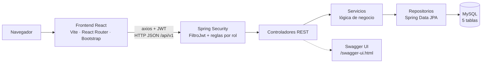
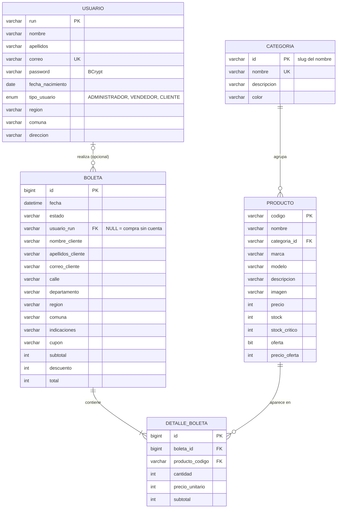
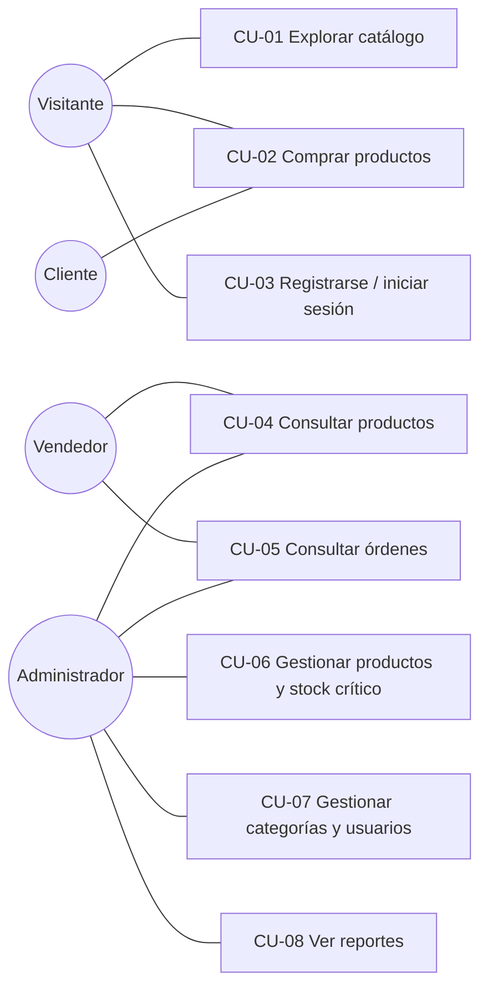
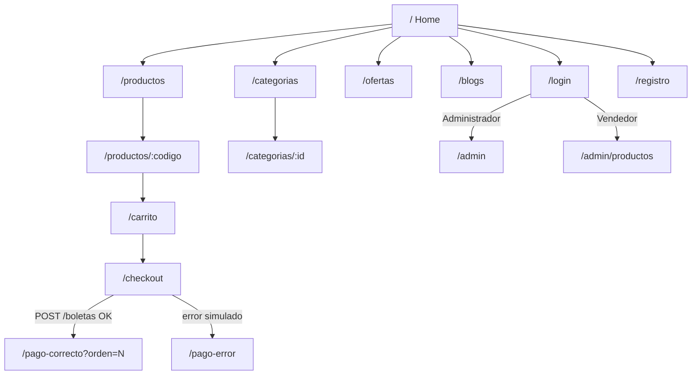
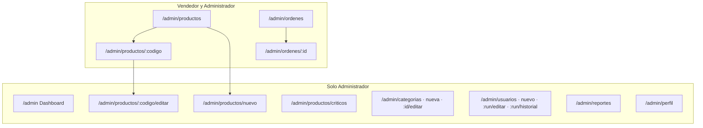

# Especificación de Requisitos de Software (ERS) — Sonido Vivo v3

Formato: IEEE 830 simplificado · **Versión 3.0** · Fecha: 06-11-2026
Asignatura: DSY1104 Desarrollo Fullstack II (Duoc UC) · Evaluación Parcial 3
Equipo: Equipo de Desarrollo Sonido Vivo

> **Nota sobre versiones.** Este documento reemplaza a la ERS v2.1 (16-10-2026), que describía la Etapa 2: una aplicación React que guardaba todo en el navegador. La v3.0 agrega el **backend** (API REST con Spring Boot, base de datos relacional y seguridad con JWT) y la **integración** del frontend con esa API. Los requisitos RF-01 a RF-30 conservan su número; los que cambian por la integración están marcados con **(v3)**. Los requisitos nuevos parten en RF-31. La sección 10 resume qué cambió de la Etapa 2 a la Etapa 3.

| Fecha | Versión | Autor | Modificación |
|---|---|---|---|
| 11-09-2026 | 1.0 | Analista de Sistemas | Versión inicial: prototipo HTML/CSS/JS |
| 08-10-2026 | 2.0 | Equipo de Desarrollo Front | Reescritura para la Etapa 2 (React) |
| 16-10-2026 | 2.1 | Equipo de Desarrollo Front | Cupones, equivalencia v1 → v2, mejoras de navbar y portada |
| 06-11-2026 | 3.0 | Equipo de Desarrollo Sonido Vivo | Etapa 3: backend Spring Boot + MySQL, API REST versionada (`/api/v1`) documentada con Swagger, Spring Security + JWT con roles, reglas de negocio trasladadas al servidor, modelo de datos de 5 tablas, rol Vendedor restringido, frontend con axios, compra sin sesión, nuevas pruebas |

---

## 1. Introducción

### 1.1 Propósito
Describir de forma completa y verificable lo que debe hacer la tienda online **Sonido Vivo** en su Etapa 3, cuando el frontend React se integra con un backend propio. Está dirigido al equipo, al docente evaluador y a futuros mantenedores, para que todos compartan la misma definición del sistema y puedan comprobar que cada requisito tiene un componente que lo implementa y una prueba que lo verifica.

### 1.2 Alcance
Sonido Vivo es una tienda online de instrumentos musicales, audio y accesorios (Viña del Mar, Región de Valparaíso). El sistema tiene tres piezas:

- **Frontend (tienda + panel):** aplicación React. La tienda incluye catálogo, búsqueda y filtros, categorías, ofertas, carrito con cupones, registro e inicio de sesión, checkout, confirmación de pago, blogs y contacto. El panel incluye dashboard, órdenes/boletas, productos (incluye críticos), categorías, usuarios, reportes y perfil.
- **Backend (`sonido-vivo-api`):** API REST con Spring Boot que implementa la lógica de negocio, la persistencia y la seguridad (autenticación con JWT y autorización por rol).
- **Base de datos relacional:** MySQL, con el modelo de 5 tablas propuesto en el enunciado (USUARIO, BOLETA, DETALLE_BOLETA, PRODUCTO, CATEGORIA).

**Fuera de alcance:** pasarela de pago real (el pago sigue siendo simulado), envío real de correos, despliegue productivo con HTTPS y la base de datos en la nube (queda **pendiente de configurar** por el equipo; la API ya está preparada para ella, ver R-07).

### 1.3 Definiciones, acrónimos y abreviaturas

| Término | Significado |
|---|---|
| ERS | Especificación de Requisitos de Software |
| SPA | *Single Page Application*: una sola página que cambia de vista sin recargar |
| API REST | Interfaz que el frontend usa por HTTP: recursos identificados por URL y operaciones GET/POST/PUT/DELETE |
| Endpoint | Combinación de método HTTP y ruta, por ejemplo `POST /api/v1/boletas` |
| Versionado de API | Prefijo `/api/v1` en todas las rutas; un cambio incompatible futuro iría en `/api/v2` sin romper a los clientes actuales |
| CRUD | Crear, obtener (leer), actualizar y eliminar |
| JWT | *JSON Web Token*: credencial firmada que el backend entrega al iniciar sesión y el frontend envía en el encabezado `Authorization: Bearer <token>` |
| BCrypt | Algoritmo de *hash* de contraseñas con sal; la contraseña original no se puede recuperar |
| JPA / Hibernate | Estándar de Java (y su implementación) para mapear clases a tablas |
| DTO | *Data Transfer Object*: forma de los datos que entra y sale de la API (distinta de la entidad de la base) |
| CORS | Regla del navegador que exige que el servidor autorice explícitamente a otro origen (el frontend) a llamarlo |
| Swagger / OpenAPI | Especificación estándar de la API (`openapi.json`) y su interfaz web interactiva |
| CLP | Peso chileno, entero; se muestra como `$129.990` |
| RUN | Rol Único Nacional chileno, con dígito verificador (`12345678-5`) |
| Stock crítico | Un producto es crítico cuando `stock <= stockCritico` (por defecto 3) |
| Boleta / orden | Registro de una compra pagada (tabla BOLETA + sus líneas en DETALLE_BOLETA) |
| Personal | Usuarios con rol Administrador o Vendedor |

### 1.4 Referencias
- DSY1104 — Evaluación Parcial 3, Anexo 1: Instrucciones (roles, modelo de datos propuesto, criterios de evaluación).
- ERS v2.1 (16-10-2026).
- Documento **APIs e Integración** (`fase3/docs/APIs_e_Integracion.md`) y especificación **OpenAPI** (`fase3/docs/openapi.json`).
- **Manual de usuario** (`fase3/docs/Manual_de_Usuario.md`).
- Documentación de React, React Router, Bootstrap 5, Vite, Vitest, axios, Spring Boot 3, Spring Security, Spring Data JPA, springdoc-openapi y jjwt.

---

## 2. Descripción general

### 2.1 Perspectiva del producto

El frontend ya no guarda datos de negocio: solo conserva en el navegador el **carrito** (`localStorage`) y la **sesión** (token y datos del usuario en `sessionStorage`). Todo lo demás (catálogo, usuarios, boletas, stock) vive en la base de datos y se consulta a través de la API.

### 2.2 Usuarios y roles

Roles definidos por el enunciado de la Evaluación 3:

| Rol | Descripción | Puede |
|---|---|---|
| **Visitante** | Persona sin sesión | Ver catálogo, categorías, ofertas, blogs; usar el carrito; registrarse; iniciar sesión; **comprar sin cuenta** |
| **Cliente** | Usuario registrado (`Cliente`) | Solo acceder a la tienda: todo lo del visitante, con los datos autocompletados en el checkout y sus compras asociadas a su cuenta |
| **Vendedor** | Personal de la tienda (`Vendedor`) | Además de la tienda: ver la **lista y el detalle de productos** y la **lista y el detalle de órdenes**. Ningún otro acceso del panel aparece en su vista ni está permitido en la API |
| **Administrador** | Personal de la tienda (`Administrador`) | Acceso total: todo el panel y todos los endpoints |

### 2.3 Restricciones
- **R-01** Backend con **Spring Boot 3** y **Java 21**; dependencias de conexión a base de datos (Spring Data JPA, driver MySQL) y de seguridad (Spring Security, jjwt).
- **R-02** Base de datos relacional **MySQL 8** con el modelo de 5 tablas del enunciado (sección 5). Para desarrollo y pruebas sin MySQL se usa **H2** en memoria (perfil `h2`), con el mismo esquema.
- **R-03** Todas las rutas de la API llevan el prefijo de versión **`/api/v1`** y están documentadas con **Swagger** (springdoc-openapi).
- **R-04** Autenticación **sin estado** con **JWT** (HMAC-SHA256, vigencia 2 horas). Autorización por rol en el servidor con Spring Security.
- **R-05** El frontend consume la API con **axios**. Stack del frontend heredado: Vite + React (JavaScript), react-router-dom, Bootstrap 5, Vitest.
- **R-06** El backend se versiona en un **repositorio GitHub separado** del frontend (`sonido-vivo-api`).
- **R-07** Credenciales y parámetros sensibles (URL, usuario y clave de la base, clave JWT, orígenes CORS) se leen de **variables de entorno**. La base de datos en la nube se configurará definiendo `DB_URL`, `DB_USER` y `DB_PASSWORD`, sin cambiar código.
- **R-08** Correos aceptados solo de los dominios `@duoc.cl`, `@profesor.duoc.cl` y `@gmail.com` (heredado). La regla se valida en el frontend **y** en el backend.
- **R-09** El pago y el envío de la boleta por email siguen siendo **simulados**.
- **R-10** Regiones y comunas: las 6 regiones de `src/utils/regiones-comunas.js` (heredado).

### 2.4 Supuestos y dependencias
- **S-01** El navegador soporta JavaScript moderno, `localStorage` y `sessionStorage`.
- **S-02** El frontend y la API pueden estar en orígenes distintos; la API debe tener el origen del frontend en `CORS_ORIGINS`.
- **S-03** Las imágenes de productos se cargan desde URL externas; las fotos de la portada van incluidas en el frontend.
- **S-04** Cuentas de demostración que la API carga al iniciar si la tabla de usuarios está vacía (contraseñas guardadas con BCrypt):

  | Rol | Correo | Contraseña |
  |---|---|---|
  | Administrador | maria.perez@gmail.com | admin123 |
  | Vendedor | carlos.munoz@duoc.cl | vend123 |
  | Cliente | camila.rojas@gmail.com | cli123 |

- **S-05** El carrito se conserva al recargar la página; la sesión se conserva al recargar, pero se cierra al cerrar la pestaña o cuando vence el token.

---

## 3. Requisitos funcionales

Prioridad: **A** alta, **M** media. **(v3)** = requisito modificado en esta versión. Cada requisito se traza a componentes y pruebas en la sección 9.

### 3.1 Módulo Tienda

| ID | Requisito | Prio. |
|---|---|:-:|
| RF-01 **(v3)** | El sistema debe mostrar una portada con hero fotográfico, la sección **Explora las categorías** (una tarjeta por categoría con foto, nombre y lema, o su color y cantidad de productos si no tiene foto) y ofertas destacadas. Categorías y productos se obtienen de la API; mientras llegan se muestra "Cargando…" | M |
| RF-02 **(v3)** | El sistema debe listar el catálogo (desde `GET /api/v1/productos`) y permitir **buscar** por nombre, marca, modelo o código, filtrando en vivo sin una petición por tecla | A |
| RF-03 | El sistema debe permitir **filtrar** por categoría y mostrar la cantidad de resultados; sin coincidencias debe mostrar "No hay productos" | A |
| RF-04 **(v3)** | El sistema debe mostrar el **detalle** de un producto (`GET /api/v1/productos/{codigo}`) con selector de cantidad limitado al stock y botón **Añadir al carrito**. Un código inexistente (404) muestra "No se encontró el producto solicitado." | A |
| RF-05 **(v3)** | El sistema debe mostrar las **tarjetas de categorías** y, al elegir una (la selección vive en la URL), los productos de esa categoría (`GET /api/v1/productos?categoria={id}`) | A |
| RF-06 **(v3)** | El sistema debe tener una vista **Ofertas** (`GET /api/v1/productos?oferta=true`) con el precio normal tachado y el precio de oferta | A |
| RF-07 | Un producto en **stock crítico** muestra "Stock crítico"; uno sin stock muestra "Sin stock" y no se puede añadir | M |
| RF-08 | El **carrito** lista los productos, permite subir/bajar cantidades (en 0 se elimina), eliminar, limpiar y ver el total. Se guarda en el navegador | A |
| RF-09 | El navbar muestra siempre el **contador** de unidades del carrito | M |
| RF-10 **(v3)** | El sistema debe permitir **registrarse** (`POST /api/v1/auth/registro`) validando RUN con dígito verificador, nombre, apellidos, correo (formato y dominio), región → comuna, dirección y contraseña de 4 a 10 caracteres con confirmación. La cuenta creada siempre es `Cliente`. El backend rechaza RUN o correo repetidos (409) y la sesión queda iniciada | A |
| RF-11 **(v3)** | El sistema debe permitir **iniciar sesión** (`POST /api/v1/auth/login`), validando en vivo y mostrando "Correo o contraseña incorrectos." cuando la API responde 401. Al entrar, el Administrador va al Dashboard, el Vendedor a Productos del panel y el Cliente a la tienda | A |
| RF-12 | El navbar muestra "Iniciar sesión / Registrarse" sin sesión, o el nombre del usuario y "Cerrar sesión" con sesión (y "Admin" al personal). Carrito e Iniciar/Cerrar sesión siempre visibles | A |
| RF-13 **(v3)** | El **checkout** captura datos del cliente y de entrega, los valida y los **autocompleta** si hay sesión. **No exige iniciar sesión**: a un visitante le ofrece iniciar sesión de forma opcional. Con el carrito vacío avisa que no hay nada que pagar | A |
| RF-14 **(v3)** | Al pagar, el frontend envía `POST /api/v1/boletas` **solo con códigos y cantidades**. Si el backend acepta, se vacía el carrito y se muestra **PagoCorrecto** con el número de boleta, datos de entrega, resumen (con los montos calculados por el backend) y los botones **Imprimir boleta** y **Enviar por email** (simulado). Si el backend rechaza la compra (stock insuficiente, cupón inválido, error de red), se muestra su mensaje y se conserva el carrito | A |
| RF-15 | Si el pago simulado falla (casilla "Simular error de pago"), el sistema muestra **PagoError**, conserva el carrito y ofrece **Volver a realizar el pago** (no se llama a la API) | A |
| RF-16 | Página **Nosotros** | M |
| RF-17 **(v3)** | **Blogs** y **detalle de blog** con enlace a la categoría relacionada. Son contenido estático del frontend (no forman parte del modelo de datos) | M |
| RF-18 | Formulario de **Contacto** (nombre y comentario obligatorios, correo opcional validado, contador de 500 caracteres) con confirmación simulada | M |
| RF-29 | El carrito permite **aplicar un cupón** (`SONIDOVIVO10` 10 %, `BIENVENIDO5` 5 %, sin distinguir mayúsculas ni espacios) con sus mensajes de válido / inválido y la opción de quitarlo | M |
| RF-30 **(v3)** | Con cupón, carrito, checkout y boleta muestran subtotal, descuento y total. En el carrito es una **vista previa**: el monto definitivo lo calcula y guarda el backend en la boleta | M |

### 3.2 Módulo Administración

| ID | Requisito | Prio. |
|---|---|:-:|
| RF-19 **(v3)** | El acceso a `/admin/*` está restringido a **Administrador** y **Vendedor** con sesión válida (token). Cada ruta del panel exige un permiso: si el rol no lo tiene, se muestra "No tienes permisos para ver esta sección." sin llamar a la API | A |
| RF-20 **(v3)** | El **Dashboard** (solo Administrador) muestra compras y total vendido, productos y cuántos están críticos, usuarios, y accesos rápidos | A |
| RF-21 **(v3)** | El panel lista las **órdenes** (`GET /api/v1/boletas`, más recientes primero, marcando las compras "Invitado") y muestra la **boleta** imprimible (`GET /api/v1/boletas/{id}`). Disponible para Administrador y Vendedor | A |
| RF-22 **(v3)** | El panel permite **listar (con búsqueda), crear, editar y eliminar productos** (solo Administrador). El código es único y no se edita; la categoría se elige de las existentes. Validaciones en frontend y backend: código 3 a 20 caracteres, nombre máx. 100, descripción máx. 500, precio entero ≥ 0, stock entero ≥ 0, stock crítico entero opcional (3 por defecto), precio de oferta obligatorio si está en oferta y ≤ precio normal | A |
| RF-23 **(v3)** | El panel tiene el listado de **productos críticos** (`GET /api/v1/productos/criticos`, solo Administrador) | A |
| RF-24 **(v3)** | El panel permite **listar, crear, editar y eliminar categorías** (solo Administrador). El id se deriva del nombre; no se permiten nombres repetidos (409); no se puede eliminar una categoría con productos (409). Al renombrar, los productos muestran el nombre nuevo porque guardan la clave foránea | A |
| RF-25 **(v3)** | El panel permite **listar, crear, editar y eliminar usuarios** (solo Administrador). RUN y correo únicos; al editar, contraseña vacía = se conserva; nadie puede eliminarse a sí mismo; al eliminar un usuario sus boletas se conservan sin dueño | A |
| RF-26 | El panel muestra el **historial de compras** de un usuario (solo Administrador) | M |
| RF-27 **(v3)** | **Reportes** (solo Administrador): total vendido, ticket promedio, unidades en stock, 5 productos más vendidos y ventas por categoría, **calculados por el backend** (`GET /api/v1/reportes/ventas`) | M |
| RF-28 **(v3)** | **Perfil** (solo Administrador en la interfaz): editar los datos propios con `PUT /api/v1/usuarios/me`, que no acepta RUN, correo ni tipo de usuario | M |

### 3.3 Backend, API e integración (nuevos en la v3)

| ID | Requisito | Prio. |
|---|---|:-:|
| RF-31 | El backend debe exponer una **API REST versionada** en `/api/v1` con operaciones CRUD sobre productos, categorías y usuarios, creación y consulta de boletas, autenticación y reportes (27 operaciones, ver documento APIs e Integración) | A |
| RF-32 | El backend debe **autenticar** con correo y contraseña y entregar un **JWT** (con RUN y rol, vigencia 2 horas). El frontend lo guarda en la sesión y un interceptor de axios lo envía en cada petición | A |
| RF-33 | El backend debe **autorizar por rol** cada endpoint según la matriz de la sección 4.1 del documento APIs e Integración: 401 sin token o con token inválido/vencido, 403 si el rol no tiene permiso | A |
| RF-34 | El **Vendedor** solo debe poder ver la lista y el detalle de productos y de órdenes: el menú lateral solo muestra esas dos secciones, la lista de productos no ofrece crear/editar/eliminar, las demás rutas del panel muestran "sin permisos" y la API le responde 403 en cualquier otra operación | A |
| RF-35 | El backend debe procesar el **checkout en una sola transacción**: agrupa los ítems repetidos, bloquea la fila de cada producto, verifica el stock de todos (si uno falla, 409 y no se descuenta nada), usa el **precio vigente de la base** (no el del navegador), valida el cupón (400 si no existe), calcula subtotal, descuento y total, descuenta el stock y guarda BOLETA + DETALLE_BOLETA | A |
| RF-36 | Se debe poder **comprar sin iniciar sesión**. Si la petición trae un token válido, la boleta queda asociada al usuario; si no, `usuario_run` queda en NULL. Los datos del cliente y de la entrega se copian en la boleta | A |
| RF-37 | Una boleta solo la puede consultar el **personal** o su **dueño**: un cliente que pide la boleta de otra persona recibe 403 y un visitante 401. Recién pagada, la confirmación se muestra con la respuesta del `POST`, sin volver a consultarla | A |
| RF-38 | La API debe estar documentada con **Swagger UI** (`/swagger-ui.html`) y publicar la especificación **OpenAPI 3** (`/v3/api-docs`, exportada en `docs/openapi.json`), con el esquema de seguridad Bearer para probar endpoints protegidos | A |
| RF-39 | Todos los errores de la API deben tener el **mismo formato JSON** (`estado`, `error`, `mensaje`, `ruta`, `fecha` y, en validaciones, `errores` por campo). El frontend muestra `mensaje` al usuario | M |
| RF-40 | Si el backend responde 401 a una petición que llevaba token (sesión vencida), el frontend debe **cerrar la sesión** y avisar "Tu sesión expiró…" | M |
| RF-41 | Un producto que ya aparece en boletas **no se puede eliminar** (409, con sugerencia de dejar su stock en 0) | M |
| RF-42 | El panel debe tener una **ficha de producto de solo lectura** (`/admin/productos/{codigo}`) para Administrador y Vendedor; el botón Editar solo aparece al Administrador | M |
| RF-43 | La API debe ofrecer a cualquier usuario autenticado sus **datos** (`GET /auth/me`, `GET /usuarios/me`) y su **historial de compras** (`GET /usuarios/me/boletas`). *Disponible en la API; la vista de cliente "Mis compras" queda para una versión futura* | M |
| RF-44 | Si la API no responde, cada pantalla con datos debe mostrar un mensaje de error de conexión y un botón **Reintentar** | M |

---

## 4. Requisitos no funcionales

| ID | Categoría | Requisito | Cómo se cumple |
|---|---|---|---|
| RNF-01 | Responsividad | Interfaz usable desde móvil (≈375 px) hasta escritorio | Bootstrap 5 (heredado de la v2): navbar colapsable, grillas, `table-responsive` |
| RNF-02 | Usabilidad | Validación en vivo con el error junto al campo; confirmación para acciones destructivas; mensajes para estados vacíos, **de carga y de error** | `FormField`, `ConfirmButton`, `EstadoCarga` (spinner accesible con `role="status"` y aviso con Reintentar); botones deshabilitados mientras se espera la respuesta |
| RNF-03 | Rendimiento | La navegación no recarga la página; el catálogo se filtra al instante | SPA; el catálogo se pide una vez y el filtrado es local; las páginas que necesitan varios recursos los piden en paralelo (`Promise.all`) |
| RNF-04 | Mantenibilidad | Separación en capas y una responsabilidad por módulo | Backend: controlador → servicio → repositorio, DTO separados de las entidades, excepciones de negocio traducidas en un único `ManejadorErrores`. Frontend: un servicio por recurso en `api/`, hook `useColeccion`, componentes presentacionales |
| RNF-05 | Persistencia | Los datos de negocio sobreviven a reinicios y se comparten entre usuarios | MySQL vía Spring Data JPA; integridad con claves foráneas y restricciones `UNIQUE` (correo, nombre de categoría) |
| RNF-06 | Consistencia | Nunca se vende más stock del que hay, ni con compras simultáneas | Checkout transaccional con bloqueo pesimista (`SELECT … FOR UPDATE`) sobre cada producto |
| RNF-07 | **Seguridad** | Contraseñas protegidas, acceso por rol y datos sensibles fuera del código | BCrypt para contraseñas; JWT firmado HMAC-SHA256 con vencimiento; API sin estado (sin sesión de servidor ni cookies, por eso CSRF no aplica); CORS limitado a orígenes configurados; la API nunca devuelve la contraseña; el token no contiene datos sensibles; login con el mismo mensaje para correo inexistente o clave incorrecta; secretos por variables de entorno |
| RNF-08 | Seguridad en el cliente | El frontend no es la barrera de seguridad | El rol guardado en la sesión solo decide qué se muestra; toda operación se autoriza en el servidor. El token va en `sessionStorage` (se borra al cerrar la pestaña) |
| RNF-09 | Configurabilidad | Cambiar de base local a nube sin tocar código | `DB_URL`, `DB_USER`, `DB_PASSWORD`, `JWT_SECRET`, `CORS_ORIGINS` (backend) y `VITE_API_URL` (frontend) |
| RNF-10 | Documentación de API | Cualquier integrante puede conocer y probar la API sin leer el código | Swagger UI con descripciones, ejemplos, códigos de respuesta y botón Authorize; `openapi.json` versionado en `docs/` |
| RNF-11 | Testabilidad | Lógica de negocio encapsulada y probada; pruebas automáticas en ambos proyectos | Backend: 76 pruebas JUnit 5 + Mockito + MockMvc. Frontend: 190 pruebas Vitest con un servidor falso en memoria, más 6 pruebas de integración contra la API real (sección 9) |
| RNF-12 | Identidad de marca | Nombre, colores y logo de Sonido Vivo | Heredado de la v2 (`theme.css`, logo en el navbar) |
| RNF-13 | Portabilidad | Navegadores recientes; backend en cualquier sistema con JDK 21+ | Frontend con APIs estándar; backend empaquetado como jar ejecutable, Maven Wrapper incluido |
| RNF-14 | Colaboración | Historial de cambios claro y repositorios separados | Repositorio del frontend (`Tienda-Sonido-Vivo`) y del backend (`sonido-vivo-api`) en GitHub, con commits descriptivos |

---

## 5. Modelo de datos

Basado en la **Figura 1** del enunciado: USUARIO ┄▸ BOLETA → DETALLE_BOLETA ← PRODUCTO ← CATEGORIA. La línea punteada entre USUARIO y BOLETA se interpreta como una **relación opcional**, porque se puede comprar sin cuenta.

**Decisiones de modelado:**
- **Claves naturales** donde ya existían en la Etapa 2: RUN (usuario), código (producto) y *slug* (categoría). Así las URL del frontend (`/productos/GA001`, `/categorias/baterias`, `/admin/usuarios/11111111-1/editar`) no cambian. Boleta y detalle usan identificadores autoincrementales.
- **Copia de datos en la boleta:** nombre, correo y dirección del cliente, y `precio_unitario` en el detalle, quedan guardados tal como estaban al comprar. El comprobante no cambia si después se edita el usuario o el precio del producto.
- **Montos en pesos enteros** (`int`): el CLP no tiene decimales.
- **Cupones y blogs no son tablas:** no aparecen en el modelo del enunciado. Los cupones son una enumeración del backend (`Cupon`) y los blogs son contenido estático del frontend.

El DDL exacto que genera Hibernate para MySQL está en `sonido-vivo-api/db/schema-mysql.sql` y en el documento APIs e Integración.

---

## 6. Casos de uso principales

**CU-01 Explorar catálogo** — *Actor:* visitante o cliente. *Flujo:* Productos → la página pide el catálogo a la API ("Cargando…") → escribe en el buscador o elige una categoría → la lista se reduce en vivo → abre el detalle. *Alternos:* sin resultados → "No hay productos"; la API no responde → aviso con **Reintentar**.

**CU-02 Comprar productos** — *Actor:* visitante o cliente. *Precondición:* carrito con productos. *Flujo:* ajusta cantidades → (opcional) aplica un cupón → Ir a pagar → completa el checkout (autocompletado si hay sesión; si no, puede seguir como invitado) → **Pagar ahora** → el backend valida stock y cupón, calcula el total y guarda la boleta → PagoCorrecto con el número de boleta. *Alternos:* datos inválidos → errores junto al campo, no se llama a la API; stock insuficiente → mensaje del backend, carrito intacto; cupón inválido → mensaje del backend; pago simulado con error → PagoError.

**CU-03 Registrarse / iniciar sesión** — *Actor:* visitante. *Flujo:* completa el formulario → la API crea la cuenta `Cliente` (o valida las credenciales) y entrega el token → queda con sesión. *Alternos:* RUN o correo repetido (409); credenciales incorrectas (401).

**CU-04 Consultar productos** — *Actor:* vendedor o administrador. *Flujo:* Panel → Productos → busca → **Ver** abre la ficha de solo lectura.

**CU-05 Consultar órdenes** — *Actor:* vendedor o administrador. *Flujo:* Panel → Órdenes / Boletas → **Ver boleta** → imprimir.

**CU-06 Gestionar productos y stock crítico** — *Actor:* administrador. *Flujo:* Nuevo producto / Editar / Eliminar (con confirmación); Productos críticos → editar para reponer. *Alternos:* código duplicado (409); producto con ventas no se elimina (409).

**CU-07 Gestionar categorías y usuarios** — *Actor:* administrador. *Flujo:* crear, editar, eliminar; historial de compras de un usuario. *Alternos:* nombre de categoría repetido; categoría con productos; RUN/correo repetido; intento de eliminarse a sí mismo.

**CU-08 Ver reportes** — *Actor:* administrador. *Flujo:* Reportes → total vendido, ticket promedio, más vendidos, ventas por categoría.

---

## 7. Mapa de navegación

### 7.1 Tienda (sin cambios de rutas respecto a la v2)

### 7.2 Administración (por rol)

Si un Vendedor abre `/admin` se le redirige a `/admin/productos`; si escribe a mano una ruta "solo Administrador" ve "No tienes permisos para ver esta sección."

---

## 8. Arquitectura y stack tecnológico

| Capa | Tecnología | Uso |
|---|---|---|
| Interfaz | React 19 (JavaScript), react-router-dom 7, Bootstrap 5.3 | SPA con dos layouts y rutas protegidas por permiso |
| Cliente HTTP | **axios 1.12** | Instancia única con `baseURL` (`VITE_API_URL`), interceptor de petición (token) y de respuesta (401 → sesión vencida) |
| Estado asíncrono | Hook propio `useColeccion` | `datos` / `cargando` / `error`, `recargar()`, descarte de respuestas viejas |
| Build frontend | Vite 8 | Desarrollo y build de producción |
| Backend | **Spring Boot 3.5** (Java 21) | `spring-boot-starter-web`, `-validation`, `-data-jpa`, `-security` |
| Persistencia | Spring Data JPA (Hibernate 6), MySQL 8 (H2 en desarrollo y pruebas) | Entidades, repositorios, bloqueo pesimista en el checkout |
| Seguridad | Spring Security 6 + jjwt 0.12 + BCrypt | Filtro JWT, reglas por rol, CORS, respuestas 401/403 en JSON |
| Documentación | springdoc-openapi 2.8 | Swagger UI y OpenAPI 3 |
| Pruebas backend | JUnit 5, Mockito, MockMvc, AssertJ, spring-security-test | Unitarias de servicios, capa web aislada (`@WebMvcTest`) e integración completa (`@SpringBootTest`) |
| Pruebas frontend | Vitest 5, Testing Library, jsdom, coverage-v8 | Servidor falso como *adapter* de axios; suite aparte contra la API real |

**Decisiones de diseño (para la exposición oral):**
- *Reglas de negocio en el servidor:* en la Etapa 2, `Checkout.jsx` revisaba el stock, calculaba el total y descontaba stock en `localStorage`, así que cualquiera podía cambiar un precio desde las herramientas del navegador. Ahora el navegador solo envía qué quiere comprar y el backend decide el resto. Lo mismo con duplicados, categorías con productos, auto-eliminación y reportes.
- *DTO en vez de entidades:* la API nunca expone la entidad `Usuario` (que tiene la contraseña). Además, los DTO conservan los nombres de campos que el frontend ya usaba (`tipoUsuario`, `categoria`, `cliente`, `items`), así las páginas casi no cambiaron.
- *Un solo cliente HTTP:* el token, la URL base y la detección de sesión vencida están en un solo archivo (`api/cliente.js`); los servicios por recurso quedan de 5 a 10 líneas.
- *Pruebas del frontend sin backend:* el servidor falso se conecta como *adapter* de axios, así las pruebas recorren el código real (interceptores incluidos). Para comprobar que imita bien a la API existe la suite `test:integracion`, que usa los mismos servicios contra el backend real.
- *Compra sin cuenta:* la relación USUARIO–BOLETA es opcional y la boleta copia los datos de contacto; por eso no hace falta un usuario "invitado" ficticio.

---

## 9. Plan de pruebas y trazabilidad

### 9.1 Plan y resultados

| Suite | Herramientas | Qué cubre | Resultado (06-11-2026) |
|---|---|---|---|
| Backend · unitarias | JUnit 5 + Mockito | Servicios de boletas (checkout), productos, categorías y usuarios; reglas puras (RUN, slug, cupones, precio vigente); JWT | 46 pruebas ✔ |
| Backend · capa web | `@WebMvcTest` + MockMvc + `@MockitoBean` | Contrato HTTP del controlador de productos con la seguridad real: filtros, 404, validación 400, 403 al vendedor, 201 al admin | 5 pruebas ✔ |
| Backend · integración | `@SpringBootTest` + MockMvc + H2 | Matriz de permisos por rol, login/registro, checkout (invitado, con sesión, sin stock, cupón), CRUD con reglas, CORS, exportación OpenAPI | 25 pruebas ✔ |
| **Total backend** | `./mvnw test` | | **76 pruebas, 0 fallos** |
| Frontend | Vitest + Testing Library + servidor falso | Páginas, componentes, contextos, hook `useColeccion`, cliente axios e interceptores, permisos del Vendedor | **190 pruebas, 0 fallos** · cobertura: sentencias 99,18 %, ramas 91,62 %, funciones 99,67 %, líneas 99,2 % |
| Integración real | Vitest (`npm run test:integracion`) contra la API en ejecución | Catálogo, login, permisos, checkout invitado y con sesión, boletas ajenas, reportes | **6 pruebas, 0 fallos** |

### 9.2 Matriz de trazabilidad (requisito ↔ implementación ↔ prueba)

| Requisito | Frontend | Backend | Pruebas |
|---|---|---|---|
| RF-01 a RF-06 | `pages/Home`, `Productos`, `Categorias`, `Ofertas`, `DetalleProducto`; `api/productos`, `api/categorias` | `ProductoControlador`, `CategoriaControlador`, `ProductoServicio.listar` | FE `paginas` · catálogo, búsqueda, filtro, categoría por URL, ofertas, detalle y 404; BE `ProductoServicioTest.listarFiltraPorTextoYOferta`, `ProductoControladorTest.listarPasaLosFiltrosAlServicio`, `ApiIntegracionTest.elCatalogoEsPublico` |
| RF-07 | `CriticalBadge`, `ProductCard` | `Producto.esStockCritico`, DTO `critico` | FE `componentes`; BE `ReglasPurasTest.precioVigenteYStockCritico` |
| RF-08, RF-09, RF-29 | `CartContext`, `Carrito`, `CartTable`, `utils/cupones` | — | FE `paginas` (carrito), `cupones` |
| RF-10 | `pages/Registro`, `api/auth` | `AuthServicio.registrar`, `UsuarioServicio.crear`, `RegistroRequest` | FE `paginas` · registro válido, correo y RUN repetidos; BE `ApiIntegracionTest.registroCreaCliente…`, `registroConCorreoExistente…`, `UsuarioServicioTest.runConDigitoVerificadorIncorrecto…` |
| RF-11, RF-32 | `pages/Login`, `SessionContext`, `api/cliente` (interceptor) | `AuthServicio.login`, `JwtServicio`, `FiltroJwt` | FE `paginas` · login correcto/incorrecto, token en peticiones; `api` · interceptor; BE `JwtServicioTest`, `ApiIntegracionTest.loginCorrecto…`, `loginIncorrectoEs401…`, `unTokenInvalidoSeTrataComoAnonimo` |
| RF-13, RF-14, RF-30, RF-35, RF-36 | `pages/Checkout` (`armarPedido`), `PagoCorrecto`, `api/boletas` | `BoletaServicio.crear`, `ProductoRepositorio.findByCodigoParaActualizar`, `Cupon` | FE `pago` · autocompleta, solo códigos y cantidades, con sesión, sin sesión, total con cupón, 409 por stock; `casos-borde` · cupón rechazado, servidor caído; BE `BoletaServicioTest` (9 pruebas), `ApiIntegracionTest.unInvitadoPuedeComprar…`, `sinStockSuficienteEs409…`, `cuponInvalidoEs400`; integración real |
| RF-15 | `pages/PagoError` | — | FE `pago` · error simulado sin llamar a la API |
| RF-17 | `data/blogs`, `Blogs`, `DetalleBlog` | — | FE `paginas` · blogs |
| RF-19, RF-34 | `RequierePermiso`, `AdminSidebar`, `AdminLayout`, `utils/roles`, `ProductosAdmin`, `ProductosTabla` | `SeguridadConfig` | FE `vendedor` (15 pruebas: permisos por rol, menú, sin crear/editar/eliminar, ficha de solo lectura, órdenes, 9 rutas prohibidas), `App` · redirección del vendedor; BE `ApiIntegracionTest.elVendedorSoloLeeProductosYOrdenes`, `ProductoControladorTest.unVendedorNoPuedeCrearProductos` |
| RF-20 | `admin/Dashboard` | `GET /boletas`, `/productos`, `/usuarios` | FE `admin` · métricas |
| RF-21, RF-37 | `admin/Ordenes`, `DetalleOrden`, `PagoCorrecto` | `BoletaServicio.obtener` / `listar` | FE `admin` · órdenes, invitado; `pago` · recarga propia, ajena; BE `BoletaServicioTest.permisosDeLectura`, `ApiIntegracionTest.unClienteNoPuedeVerBoletasAjenas` |
| RF-22, RF-41, RF-42 | `ProductoNuevo`, `ProductoEditar`, `ProductoDetalleAdmin`, `ProductoForm` | `ProductoServicio`, `ProductoRequest` | FE `admin` · crear, código repetido, validaciones, editar, eliminar, con ventas, ficha; BE `ProductoServicioTest`, `ProductoControladorTest.crearValidaElCuerpo…`, `ApiIntegracionTest.crearEditarYEliminarProducto`, `unProductoVendidoNoSePuedeEliminar` |
| RF-23 | `admin/ProductosCriticos` | `ProductoRepositorio.findCriticos` | FE `admin` · críticos |
| RF-24 | `CategoriasAdmin`, `CategoriaNueva`, `CategoriaEditar` | `CategoriaServicio` | FE `admin` · categorías (7); BE `CategoriaServicioTest` (7), `ApiIntegracionTest.reglasDeCategorias` |
| RF-25, RF-26 | `UsuariosAdmin`, `UsuarioNuevo`, `UsuarioEditar`, `HistorialCompras` | `UsuarioServicio`, `BoletaServicio.deUsuario` | FE `admin` · usuarios (8), historial; BE `UsuarioServicioTest` (10), `ApiIntegracionTest.reglasDeUsuarios` |
| RF-27 | `admin/Reportes`, `api/reportes` | `ReporteServicio` | FE `admin` · reportes; BE `ApiIntegracionTest.elReporteReflejaLasVentas` |
| RF-28 | `admin/Perfil` | `UsuarioServicio.actualizarPerfil` | FE `admin` · perfil; BE `UsuarioServicioTest.elPerfilNoCambiaRolNiCorreo`, `ApiIntegracionTest.elPerfilPropioNoPermiteCambiarElRol` |
| RF-31, RF-33 | `api/*` | Controladores, `SeguridadConfig` | BE `ApiIntegracionTest` · Permisos por rol (5), `sinTokenLasRutasProtegidasResponden401` |
| RF-38 | — | `AppConfig` (OpenAPI), anotaciones `@Operation` | BE `ApiIntegracionTest.exportaOpenApi` |
| RF-39 | `mensajeDeError`, `EstadoCarga` | `ManejadorErrores`, `ErrorRespuesta` | FE `api` · mensajeDeError; BE `ProductoControladorTest.unProductoInexistenteResponde404ConMensaje` |
| RF-40 | `api/cliente` (interceptor), `SessionContext`, `AdminLayout` | 401 del `authenticationEntryPoint` | FE `api` · evento de sesión expirada; `admin` · token vencido cierra la sesión |
| RF-44 | `EstadoCarga`, `useColeccion.recargar` | — | FE `paginas` · API caída y Reintentar; `api` · useColeccion error → recargar |
| RNF-06 | — | Bloqueo pesimista + `@Transactional` | BE `BoletaServicioTest.sinStock` (no descuenta nada), `ApiIntegracionTest.sinStockSuficienteEs409YNoSeDescuentaNada` |
| RNF-07 | — | BCrypt, JWT, `UsuarioDTO` sin password | BE `UsuarioServicioTest.crearGuardaLaContrasenaCifrada`, `JwtServicioTest`, `ApiIntegracionTest.loginCorrectoDevuelveTokenYUsuarioSinPassword`, `corsPermiteElFrontend` |

---

## 10. Qué cambió respecto a la Etapa 2

| Aspecto | Etapa 2 | Etapa 3 |
|---|---|---|
| Arquitectura | Solo frontend; "base de datos" simulada en `localStorage` (`db.js`, síncrono, usado por 27 archivos) | Frontend + API REST Spring Boot + MySQL; `db.js` eliminado |
| Acceso a datos en el frontend | `listar()` / `obtener()` síncronos al dibujar | Servicios axios por recurso + `useColeccion` con estados de carga y error |
| Modelo | 5 colecciones JSON (productos, categorías, usuarios, órdenes, blogs) | 5 tablas relacionales del enunciado con claves foráneas; blogs pasan a contenido estático; la orden se normaliza en BOLETA + DETALLE_BOLETA |
| Autenticación | Comparación de contraseñas en texto plano en el navegador | Login en el servidor, BCrypt, JWT con vencimiento |
| Autorización | Solo de interfaz; Vendedor = Administrador | Reglas por rol en Spring Security (401/403) + interfaz por permisos; Vendedor limitado a ver productos y órdenes |
| Checkout | El navegador validaba stock, calculaba el total y descontaba stock | El servidor lo hace en una transacción con bloqueo; el navegador solo envía códigos y cantidades |
| Compra sin cuenta | Permitida (orden con `run: null`) | Permitida; BOLETA.usuario_run opcional |
| Reportes | Calculados en el navegador (`utils/reportes.js`) | Calculados por el backend (`ReporteServicio`) |
| Renombrar categoría | Había que reescribir la categoría de cada producto | Automático: el producto guarda la FK |
| Sesión | `localStorage`, sin token | Token + usuario en `sessionStorage`; se cierra al vencer el token |
| Precios | Decimales permitidos | Enteros (CLP), validados en ambos lados |
| Documentación de API | — | Swagger UI + `openapi.json` |
| Pruebas | 172 (frontend) | 76 backend + 190 frontend + 6 de integración real |
| Repositorios | Uno | Frontend y backend en repositorios separados |

**Se mantuvo:** rutas y diseño de la tienda, identidad de marca, catálogo de 51 productos en 10 categorías, reglas de validación (RUN, dominios de correo, largos), cupones y regiones/comunas.

---

## 11. Pendientes y riesgos

| ID | Tema | Estado / mitigación |
|---|---|---|
| P-01 | Base de datos en la nube | Pendiente. La API solo necesita `DB_URL`, `DB_USER` y `DB_PASSWORD`; el script `db/schema-mysql.sql` permite crear las tablas a mano si se prefiere |
| P-02 | Clave JWT de producción | Definir `JWT_SECRET` propio al desplegar (la de desarrollo es pública en el repositorio) |
| P-03 | HTTPS | Requerido en un despliegue real para que el token no viaje en claro |
| P-04 | Vista "Mis compras" del cliente | El endpoint existe (`GET /usuarios/me/boletas`); falta la pantalla |
| P-05 | Pasarela de pago real y correo real | Fuera de alcance; siguen simulados |
| P-06 | Repositorio remoto del backend | Crear `sonido-vivo-api` en GitHub y publicar (instrucciones en su README) |
